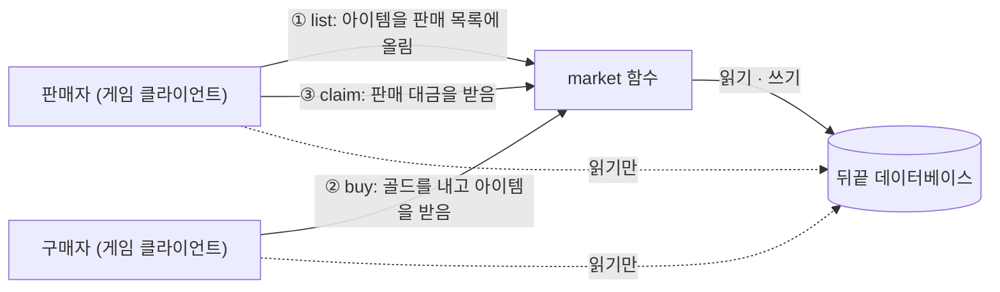

# 거래소 만들기

플레이어끼리 아이템을 사고파는 거래소를 뒤끝펑션으로 만드는 튜토리얼입니다. 판매 등록, 구매, 판매 취소, 판매 대금 받기를 함수 하나(`market`)로 처리합니다.  
게임 클라이언트는 데이터베이스를 **읽기만** 하고, 골드와 아이템을 바꾸는 **쓰기는 함수에서만** 합니다. 클라이언트가 지갑 값을 직접 바꾸지 못하게 만드는 구성입니다.  

## 준비 사항

- [아이템 뽑기](/sdk-docs/function/tutorial/gacha) 튜토리얼을 먼저 진행해 주세요. 이 튜토리얼은 아이템 뽑기에서 만든 `wallet`, `inventory` 테이블과 테스트 계정 프로필(`seller`), 그 계정이 뽑은 아이템을 그대로 사용합니다.
- 구매자로 쓸 **테스트 전용 계정 1개**가 더 필요합니다. 실제로 존재하는 계정이어야 합니다.
- 데이터베이스를 함수에서 쓰는 방법은 [뒤끝 데이터베이스 사용](/sdk-docs/function/backnd-features/database) 문서에서 볼 수 있습니다. 미리 읽어 두면 코드를 이해하기 쉽습니다.

아래 명령은 Windows PowerShell 기준입니다. Mac에서는 터미널에서 같은 명령을 사용하고, 경로만 Mac 형식으로 바꿉니다.  

:::caution 테스트용 프로젝트에서 진행해 주세요
이 튜토리얼은 테이블을 만들고 데이터를 직접 넣으며, 호출할 때마다 실제 데이터가 바뀝니다.  
운영 중인 프로젝트가 아니라 테스트용 프로젝트에서 진행해 주세요.  
:::

## 동작 개요



실선은 게임 클라이언트의 함수 호출과 함수의 데이터베이스 접근이고, 점선은 클라이언트가 데이터베이스를 직접 읽는 것입니다. 클라이언트는 테이블 권한으로 쓰기가 막혀 있어서, 데이터를 바꾸려면 반드시 `market` 함수를 거칩니다.  
서버에 배포한 함수는 테이블의 클라이언트 접근 권한을 받지 않으므로, 막아 둔 테이블에도 쓸 수 있습니다.  

함수는 요청의 `action` 값으로 동작을 나눕니다.  

| action | 보내는 값 | 하는 일 |
| --- | --- | --- |
| `open` | 없음 | 내 지갑이 없으면 만들고(골드 0), 내 `userId`와 `gold`를 돌려줍니다. |
| `list` | `itemId`, `price` | 내 인벤토리의 아이템을 판매 목록에 올립니다. |
| `buy` | `listingId` | 판매 목록의 아이템을 사서 내 인벤토리에 넣고, 가격만큼 내 골드를 뺍니다. |
| `cancel` | `listingId` | 내 판매 등록을 취소하고 아이템을 인벤토리로 돌려받습니다. |
| `claim` | `listingId` | 내 아이템이 팔린 대금을 내 지갑으로 받습니다. |

### 판매 대금을 바로 지급하지 않는 이유

구매자가 `buy`를 호출하면 함수는 구매자의 지갑에서 골드를 뺍니다. 그런데 판매자의 지갑에는 골드를 넣을 수 없습니다.  
유저 테이블은 함수에서도 **호출한 사용자 본인의 행만** 다룰 수 있기 때문입니다. 배포한 함수도 같습니다.  

그래서 판매 대금은 자유 테이블 `market_settlement`에 "판매자(`seller_id`)에게 줄 골드"로 기록해 둡니다. 판매자가 `claim`을 호출하면, 함수는 그 기록의 판매자와 호출한 사용자가 같은지 확인한 뒤 판매자 본인의 지갑에 골드를 넣습니다.  

## 1. 테이블 만들기

뒤끝 콘솔의 [테이블 에디터](/guide/console-guide/database/table-editor)에서 테이블 2개를 만듭니다. 테이블 이름과 컬럼 이름은 아래와 같이 영문 소문자와 언더바(`_`)로 입력합니다.  
테이블을 만든 뒤에는 컬럼을 수정할 수 없고 추가만 할 수 있으므로, 타입을 확인하고 만들어 주세요.  
`wallet`(골드)과 `inventory`(아이템)는 아이템 뽑기에서 만든 테이블을 그대로 사용합니다.  

### market_listing (자유 테이블)

판매 목록입니다. 누구나 볼 수 있습니다.  

| 컬럼 | 타입 | 설명 |
| --- | --- | --- |
| `listing_id` | string | **기본 키.** 판매 목록 ID입니다. |
| `seller_id` | string | 판매자의 gamerId입니다. |
| `item_id` | string | 판매하는 아이템의 고유 ID입니다. |
| `item_code` | string | 판매하는 아이템의 종류 코드입니다. |
| `price` | int64 | 가격(골드)입니다. |
| `status` | string | `open`(판매 중), `sold`(판매 완료), `cancelled`(취소) 중 하나입니다. |
| `buyer_id` | string | 구매자의 gamerId입니다. 판매 중에는 비어 있으므로 **Nullable**로 만듭니다. |

### market_settlement (자유 테이블)

판매자가 받을 대금을 기록합니다. 함수만 다룹니다.  

| 컬럼 | 타입 | 설명 |
| --- | --- | --- |
| `listing_id` | string | **기본 키.** 판매 목록 ID입니다. 판매 하나에 정산은 한 번만 생깁니다. |
| `seller_id` | string | 대금을 받을 판매자의 gamerId입니다. |
| `gold` | int64 | 받을 골드입니다. |
| `status` | string | `pending`(받기 전), `claimed`(받음) 중 하나입니다. |

### 클라이언트 접근 권한

테이블을 만들 때 [클라이언트 접근 권한](/guide/console-guide/database/table-editor#클라이언트-접근-권한)을 아래와 같이 설정합니다. `wallet`, `inventory`는 아이템 뽑기에서 설정한 그대로 둡니다.  

| 테이블 | 읽기 | 쓰기 |
| --- | --- | --- |
| `market_listing` | 허용 | 모두 해제 |
| `market_settlement` | 해제 | 해제 |

:::danger 쓰기 권한을 모두 해제해 주세요
쓰기 권한이 하나라도 남아 있으면 게임 클라이언트가 함수를 거치지 않고 테이블에 직접 쓸 수 있습니다. 예를 들어 `market_listing`의 쓰기를 열어 두면 클라이언트가 판매 목록의 가격이나 상태를 마음대로 바꿀 수 있습니다.  
자유 테이블(`market_listing`, `market_settlement`)은 행의 소유자를 구분하지 않으므로, 쓰기 권한을 모두 해제해야 다른 사용자의 행까지 막을 수 있습니다.  
:::

## 2. 프로젝트 만들기

```powershell
mkdir C:\work -Force
cd C:\work
backend new market
cd market
```

프로젝트 이름 `market`이 서버에 배포될 함수 이름이 됩니다.  

## 3. 함수 작성하기

뒤끝 콘솔의 데이터베이스 [설정](/guide/console-guide/database/settings) 화면에서 **UUID**를 복사해 둡니다.  
`Function.cs`의 내용을 모두 지우고 아래 코드로 바꾼 뒤, `DATABASE_UUID`의 값을 복사한 UUID로 바꿉니다.  

```csharp
using System;
using System.IO;
using System.Threading.Tasks;
using Amazon.Lambda.Core;
using BackEnd;
using BACKND.Database;
using BACKND.Database.Exceptions;
using Newtonsoft.Json.Linq;

[assembly: LambdaSerializer(typeof(Amazon.Lambda.Serialization.Json.JsonSerializer))]

namespace BackendFunction
{
    // 지갑: 유저 테이블. 호출한 사용자 본인의 행만 다룹니다.
    [Table("wallet", TableType.UserTable)]
    public class Wallet : BaseModel
    {
        [PrimaryKey]
        [Column("owner_id", NotNull = true)]
        public string OwnerId { get; set; }

        [Column("gold", NotNull = true)]
        public long Gold { get; set; }
    }

    // 인벤토리: 유저 테이블. 호출한 사용자 본인의 행만 다룹니다.
    [Table("inventory", TableType.UserTable)]
    public class InventoryItem : BaseModel
    {
        [PrimaryKey]
        [Column("item_id", NotNull = true)]
        public string ItemId { get; set; }

        [Column("item_code", NotNull = true)]
        public string ItemCode { get; set; }
    }

    // 판매 목록: 자유 테이블. 누구나 읽을 수 있고 쓰기는 함수만 합니다.
    [Table("market_listing", TableType.FlexibleTable)]
    public class MarketListing : BaseModel
    {
        [PrimaryKey]
        [Column("listing_id", NotNull = true)]
        public string ListingId { get; set; }

        [Column("seller_id", NotNull = true)]
        public string SellerId { get; set; }

        [Column("item_id", NotNull = true)]
        public string ItemId { get; set; }

        [Column("item_code", NotNull = true)]
        public string ItemCode { get; set; }

        [Column("price", NotNull = true)]
        public long Price { get; set; }

        [Column("status", NotNull = true)]
        public string Status { get; set; }

        [Column("buyer_id")]
        public string BuyerId { get; set; }
    }

    // 정산 기록: 자유 테이블. 함수만 읽고 씁니다.
    [Table("market_settlement", TableType.FlexibleTable)]
    public class MarketSettlement : BaseModel
    {
        [PrimaryKey]
        [Column("listing_id", NotNull = true)]
        public string ListingId { get; set; }

        [Column("seller_id", NotNull = true)]
        public string SellerId { get; set; }

        [Column("gold", NotNull = true)]
        public long Gold { get; set; }

        [Column("status", NotNull = true)]
        public string Status { get; set; }
    }

    public class BFunc
    {
        // 뒤끝 콘솔의 데이터베이스 설정 화면에서 복사한 UUID로 바꿉니다.
        private const string DATABASE_UUID = "00000000-0000-0000-0000-000000000000";

        private const long MAX_PRICE = 1000000;
        private const int MAX_ID_LENGTH = 64;

        private const string STATUS_OPEN = "open";
        private const string STATUS_SOLD = "sold";
        private const string STATUS_CANCELLED = "cancelled";
        private const string STATUS_PENDING = "pending";
        private const string STATUS_CLAIMED = "claimed";

        private static Client sDb;

        public async Task<Stream> Function(Stream stream, ILambdaContext context)
        {
            try
            {
                // 뒤끝펑션 SDK를 초기화합니다.
                Backend.Initialize(ref stream);
            }
            catch (Exception e)
            {
                return ReturnErrorObject("initialize " + e.Message);
            }

            // 1. 요청 값을 확인합니다. 클라이언트가 보낸 값은 믿지 않고, 먼저 모양과 범위를 확인합니다.
            string action = ReadString("action");

            if (action == null)
            {
                return ReturnErrorObject("action key is not exist");
            }

            string itemId = ReadId("itemId");
            string listingId = ReadId("listingId");
            bool hasPrice = TryReadPrice(out long price);

            string requestError = CheckRequest(action, itemId, listingId, hasPrice);

            if (requestError != null)
            {
                return ReturnErrorObject(requestError);
            }

            try
            {
                // 2. 호출한 사용자를 확인합니다. 사용자 ID는 요청 값이 아니라 서버가 확인한 값만 사용합니다.
                var userInfo = Backend.BMember.GetUserInfoV2();

                if (userInfo.IsSuccess() == false)
                {
                    return ReturnErrorObject("fail to get user info: " + userInfo.GetMessage());
                }

                string userId = userInfo.GetReturnValuetoJSON()["row"]["gamerId"].ToString();

                // 3. 동작을 실행합니다.
                switch (action)
                {
                    case "open":
                        return await Open(userId);

                    case "list":
                        return await ListItem(userId, itemId, price);

                    case "buy":
                        return await Buy(userId, listingId);

                    case "cancel":
                        return await Cancel(userId, listingId);

                    case "claim":
                        return await Claim(userId, listingId);

                    default:
                        return ReturnErrorObject("unknown action: " + action);
                }
            }
            catch (DatabaseException e)
            {
                // FailureKind로 실패 원인을 구분할 수 있습니다.
                return ReturnErrorObject("database " + e.FailureKind + ": " + e.Message);
            }
            catch (Exception e)
            {
                return ReturnErrorObject("unexpected error: " + e.Message);
            }
        }

        // open: 지갑이 없으면 만들고, 내 gamerId와 골드를 돌려줍니다.
        static async Task<Stream> Open(string userId)
        {
            Client db = GetDb();

            Wallet wallet = await db.From<Wallet>().OfCurrentUser().Where(x => x.OwnerId == userId).FirstOrDefault();

            if (wallet == null)
            {
                wallet = new Wallet { OwnerId = userId, Gold = 0 };
                await db.From<Wallet>().OfCurrentUser().Insert(wallet);
            }

            JObject result = NewOkObject("open");
            result.Add("userId", userId);
            result.Add("gold", wallet.Gold);

            return Backend.StringToStream(result.ToString());
        }

        // list: 내 아이템을 판매 목록에 올립니다. 인벤토리에서 빼는 일과 목록에 올리는 일을 한 트랜잭션으로 묶습니다.
        static async Task<Stream> ListItem(string userId, string itemId, long price)
        {
            Client db = GetDb();

            // 내 인벤토리에 있는 아이템인지 확인하고 item_code를 가져옵니다.
            InventoryItem item = await db.From<InventoryItem>().OfCurrentUser().Where(x => x.ItemId == itemId).FirstOrDefault();

            if (item == null)
            {
                return ReturnErrorObject("item not found in your inventory");
            }

            string listingId = Guid.NewGuid().ToString();

            // buyer_id는 비워 둡니다(null).
            MarketListing listing = new MarketListing { ListingId = listingId, SellerId = userId, ItemId = item.ItemId, ItemCode = item.ItemCode, Price = price, Status = STATUS_OPEN };

            TransactionBuilder tx = db.Transaction();

            // 1. 내 인벤토리에서 아이템을 지웁니다. 아이템이 없으면 트랜잭션 전체가 취소됩니다.
            tx.From<InventoryItem>().OfCurrentUser().Where(x => x.ItemId == itemId).Delete();

            // 2. 판매 목록에 올립니다.
            tx.From<MarketListing>().Insert(listing);

            TransactionResult commit = await tx.Commit();

            if (commit.Success == false)
            {
                return ReturnErrorObject("list failed: " + commit.Error);
            }

            JObject result = NewOkObject("list");
            result.Add("listingId", listingId);

            return Backend.StringToStream(result.ToString());
        }

        // buy: 판매 목록의 아이템을 삽니다. 4개의 쓰기를 한 트랜잭션으로 묶습니다.
        static async Task<Stream> Buy(string userId, string listingId)
        {
            Client db = GetDb();

            // 판매 목록을 읽습니다. 가격은 요청 값이 아니라 이 목록에서 가져옵니다.
            MarketListing listing = await db.From<MarketListing>().Where(x => x.ListingId == listingId).FirstOrDefault();

            if (listing == null)
            {
                return ReturnErrorObject("listing not found");
            }

            if (listing.Status != STATUS_OPEN)
            {
                return ReturnErrorObject("listing is not open");
            }

            if (listing.SellerId == userId)
            {
                return ReturnErrorObject("cannot buy your own listing");
            }

            // Where 식에는 listing.Price처럼 객체의 프로퍼티를 쓸 수 없으므로 지역 변수에 담아 둡니다.
            long price = listing.Price;
            string sellerId = listing.SellerId;
            string itemId = listing.ItemId;
            string itemCode = listing.ItemCode;

            TransactionBuilder tx = db.Transaction();

            // 1. 판매 목록을 "sold"로 바꿉니다. 아직 "open"이고 가격이 읽은 값과 같을 때만 바뀝니다.
            tx.From<MarketListing>().Where(x => x.ListingId == listingId && x.Status == STATUS_OPEN && x.Price == price).Set(x => x.Status, STATUS_SOLD).Set(x => x.BuyerId, userId).Update();

            // 2. 내 지갑에서 골드를 뺍니다. 골드가 가격 이상일 때만 바뀝니다.
            tx.From<Wallet>().OfCurrentUser().Where(x => x.OwnerId == userId && x.Gold >= price).Dec(x => x.Gold, price).Update();

            // 3. 내 인벤토리에 아이템을 넣습니다.
            tx.From<InventoryItem>().OfCurrentUser().Insert(new InventoryItem { ItemId = itemId, ItemCode = itemCode });

            // 4. 판매자가 받을 대금을 정산 기록으로 남깁니다. 기본 키가 판매 목록 ID라서 판매 하나에 정산은 한 번만 생깁니다.
            tx.From<MarketSettlement>().Insert(new MarketSettlement { ListingId = listingId, SellerId = sellerId, Gold = price, Status = STATUS_PENDING });

            TransactionResult commit = await tx.Commit();

            if (commit.Success == false)
            {
                return ReturnErrorObject("buy failed: " + commit.Error);
            }

            JObject result = NewOkObject("buy");
            result.Add("listingId", listingId);
            result.Add("itemId", itemId);
            result.Add("price", price);

            return Backend.StringToStream(result.ToString());
        }

        // cancel: 내 판매 등록을 취소하고 아이템을 인벤토리로 돌려받습니다.
        static async Task<Stream> Cancel(string userId, string listingId)
        {
            Client db = GetDb();

            MarketListing listing = await db.From<MarketListing>().Where(x => x.ListingId == listingId).FirstOrDefault();

            if (listing == null)
            {
                return ReturnErrorObject("listing not found");
            }

            if (listing.SellerId != userId)
            {
                return ReturnErrorObject("only the seller can cancel");
            }

            if (listing.Status != STATUS_OPEN)
            {
                return ReturnErrorObject("listing is not open");
            }

            string itemId = listing.ItemId;
            string itemCode = listing.ItemCode;

            TransactionBuilder tx = db.Transaction();

            // 1. 판매 목록을 "cancelled"로 바꿉니다. 내 판매 등록이고 아직 "open"일 때만 바뀝니다.
            tx.From<MarketListing>().Where(x => x.ListingId == listingId && x.SellerId == userId && x.Status == STATUS_OPEN).Set(x => x.Status, STATUS_CANCELLED).Update();

            // 2. 아이템을 내 인벤토리로 돌려줍니다.
            tx.From<InventoryItem>().OfCurrentUser().Insert(new InventoryItem { ItemId = itemId, ItemCode = itemCode });

            TransactionResult commit = await tx.Commit();

            if (commit.Success == false)
            {
                return ReturnErrorObject("cancel failed: " + commit.Error);
            }

            JObject result = NewOkObject("cancel");
            result.Add("listingId", listingId);
            result.Add("itemId", itemId);

            return Backend.StringToStream(result.ToString());
        }

        // claim: 판매 대금을 정산 받아 내 지갑에 넣습니다. 판매자 본인만 받을 수 있습니다.
        static async Task<Stream> Claim(string userId, string listingId)
        {
            Client db = GetDb();

            MarketSettlement settlement = await db.From<MarketSettlement>().Where(x => x.ListingId == listingId).FirstOrDefault();

            if (settlement == null)
            {
                return ReturnErrorObject("settlement not found");
            }

            if (settlement.SellerId != userId)
            {
                return ReturnErrorObject("this settlement is not yours");
            }

            if (settlement.Status != STATUS_PENDING)
            {
                return ReturnErrorObject("settlement is already claimed");
            }

            long gold = settlement.Gold;

            TransactionBuilder tx = db.Transaction();

            // 1. 정산 기록을 "claimed"로 바꿉니다. 내 정산이고 아직 "pending"일 때만 바뀝니다.
            tx.From<MarketSettlement>().Where(x => x.ListingId == listingId && x.SellerId == userId && x.Status == STATUS_PENDING && x.Gold == gold).Set(x => x.Status, STATUS_CLAIMED).Update();

            // 2. 내 지갑에 골드를 더합니다. 지갑이 없으면 트랜잭션 전체가 취소됩니다.
            tx.From<Wallet>().OfCurrentUser().Where(x => x.OwnerId == userId).Inc(x => x.Gold, gold).Update();

            TransactionResult commit = await tx.Commit();

            if (commit.Success == false)
            {
                return ReturnErrorObject("claim failed: " + commit.Error);
            }

            JObject result = NewOkObject("claim");
            result.Add("listingId", listingId);
            result.Add("gold", gold);

            return Backend.StringToStream(result.ToString());
        }

        // 동작에 필요한 요청 값이 올바른지 확인합니다. 올바르면 null, 아니면 오류 메시지를 돌려줍니다.
        static string CheckRequest(string action, string itemId, string listingId, bool hasPrice)
        {
            switch (action)
            {
                case "open":
                    return null;

                case "list":
                    if (itemId == null)
                    {
                        return "itemId is required (1-" + MAX_ID_LENGTH + " characters)";
                    }

                    if (hasPrice == false)
                    {
                        return "price must be an integer between 1 and " + MAX_PRICE;
                    }

                    return null;

                case "buy":
                case "cancel":
                case "claim":
                    if (listingId == null)
                    {
                        return "listingId is required (1-" + MAX_ID_LENGTH + " characters)";
                    }

                    return null;

                default:
                    return "unknown action: " + action;
            }
        }

        // 요청에서 문자열 값을 읽습니다. 키가 없거나 비어 있으면 null을 돌려줍니다.
        static string ReadString(string key)
        {
            if (Backend.HasKey(key) == false)
            {
                return null;
            }

            var value = Backend.Content[key];

            if (value == null)
            {
                return null;
            }

            string text = value.ToString();

            if (string.IsNullOrWhiteSpace(text))
            {
                return null;
            }

            return text;
        }

        // ID 값을 읽습니다. 값이 없거나 MAX_ID_LENGTH보다 길면 null을 돌려줍니다.
        static string ReadId(string key)
        {
            string id = ReadString(key);

            if (id == null || id.Length > MAX_ID_LENGTH)
            {
                return null;
            }

            return id;
        }

        // price를 읽어 1 이상 MAX_PRICE 이하의 정수인지 확인합니다.
        static bool TryReadPrice(out long price)
        {
            price = 0;

            string text = ReadString("price");

            if (text == null)
            {
                return false;
            }

            if (long.TryParse(text, out price) == false)
            {
                return false;
            }

            return price >= 1 && price <= MAX_PRICE;
        }

        // 데이터베이스 클라이언트를 처음 필요할 때 한 번 만들어 재사용합니다.
        static Client GetDb()
        {
            if (sDb == null)
            {
                sDb = new Client(DATABASE_UUID);
            }

            return sDb;
        }

        static JObject NewOkObject(string action)
        {
            JObject result = new JObject();
            result.Add("ok", true);
            result.Add("action", action);

            return result;
        }

        static Stream ReturnErrorObject(string err)
        {
            JObject error = new JObject();
            error.Add("error", err);

            return Backend.StringToStream(error.ToString());
        }
    }
}
```

UUID를 바꾸지 않으면 데이터베이스를 쓰는 시점에 `database Validation: The database UUID must be non-empty and use the canonical 8-4-4-4-12 format.` 오류가 반환됩니다.  

### 코드에서 확인할 점

- **모델 클래스**: 콘솔에서 만든 테이블과 테이블 이름, 컬럼 이름, 타입이 같아야 합니다. 유저 테이블(`Wallet`, `InventoryItem`) 쿼리에는 `OfCurrentUser()`를 붙이고, 자유 테이블에는 붙이지 않습니다.
- **모델의 권한 값**: 모델의 `[Table]`에는 클라이언트 접근 권한을 적지 않았습니다. 테이블의 권한은 콘솔에서 테이블을 만들 때 설정한 값이 적용되고, 모델의 권한 값은 코드로 테이블을 만들 때(`CreateTable`)만 쓰입니다.
- **처리 순서**: 요청 값 확인, 호출한 사용자 확인, 동작 실행 순서입니다. 잘못된 요청은 서버에 사용자 확인을 요청하기 전에 돌려보냅니다. 요청 값은 [요청 값 읽기](/sdk-docs/function/request-response/read-input)를 참고해 주세요.
- **호출한 사용자**: 사용자 ID는 요청 값으로 받지 않고 `Backend.BMember.GetUserInfoV2()`로 서버에서 확인합니다. [호출한 사용자 확인하기](/sdk-docs/function/request-response/caller)
- **Where 식의 값**: 상수나 지역 변수만 쓸 수 있습니다. `listing.Price`처럼 객체의 프로퍼티를 직접 쓰면 실행할 때 거부되므로 `long price = listing.Price;`처럼 지역 변수에 담았습니다.
- **상태 값**: `open`, `sold`, `cancelled`, `pending`, `claimed`를 문자열로 저장합니다. 문자열은 `==`와 `!=`로만 비교할 수 있습니다.
- **결과 확인**: `Commit()`은 실패해도 예외를 던지지 않습니다. 반드시 `commit.Success`를 확인하고 이유는 `commit.Error`로 돌려줍니다.
- **돌려주는 값**: 성공하면 `{"ok": true, ...}`, 실패하면 `{"error": "..."}`를 반환합니다. [결과 반환하기](/sdk-docs/function/request-response/return-result)

동작마다 트랜잭션에 넣은 쓰기와, 트랜잭션 전체가 취소되는 경우는 아래와 같습니다.  
트랜잭션은 전부 반영되거나 전부 취소되며, `Update`와 `Delete`의 `Where`에는 기본 키를 `==`로 지정합니다.  

| 동작 | 트랜잭션에 넣은 쓰기 | 트랜잭션 전체가 취소되는 경우 |
| --- | --- | --- |
| `list` | 내 인벤토리에서 아이템 삭제, 판매 목록 추가 | 내 인벤토리에 아이템이 없습니다. |
| `buy` | 판매 목록을 `sold`로 변경, 내 골드 차감, 내 인벤토리에 아이템 추가, 정산 기록 추가 | 이미 팔렸거나 가격이 달라졌습니다. 골드가 모자랍니다. |
| `cancel` | 판매 목록을 `cancelled`로 변경, 내 인벤토리에 아이템 추가 | 내 판매 등록이 아니거나 이미 `open`이 아닙니다. |
| `claim` | 정산 기록을 `claimed`로 변경, 내 골드 증가 | 내 정산이 아니거나 이미 받았습니다. 내 지갑이 없습니다. |

## 4. 내 PC에서 확인하기

이 함수는 데이터베이스에 쓰기 때문에 내 PC에서는 **요청 값 확인까지만** 시험할 수 있습니다. 먼저 인증 정보 없이 실행해 요청 값 확인이 동작하는지 봅니다.  

`requests/default.json`의 내용을 아래와 같이 바꾸고 실행합니다. 이 파일의 내용이 함수에 전달됩니다.  

```json
{}
```

```powershell
backend debug
```

결과의 `execution`이 아래와 같으면 정상입니다. `action` 값이 없어서 오류를 돌려준 것입니다.  

```json
"execution": {
  "error": null,
  "ok": true,
  "result": {
    "error": "action key is not exist"
  }
}
```

이번에는 가격이 올바르지 않은 요청을 보냅니다. `requests/bad-price.json` 파일을 만들고 아래 내용을 넣습니다.  

```json
{
  "action": "list",
  "itemId": "sword-0001",
  "price": 0
}
```

```powershell
backend debug --data bad-price
```

`result`에 가격 오류가 표시되면 정상입니다.  

```json
"result": {
  "error": "price must be an integer between 1 and 1000000"
}
```

마지막으로 올바른 요청이 사용자 확인 단계까지 가는지 봅니다. `requests/open.json` 파일을 만들고 아래 내용을 넣습니다.  

```json
{
  "action": "open"
}
```

```powershell
backend debug --data open
```

인증 정보 없이 실행했으므로 호출한 사용자를 확인하지 못하고 멈춥니다. `result`의 `error`가 `fail to get user info:`로 시작하면 정상입니다. 뒤에는 사용자를 확인하지 못한 이유가 이어집니다.  

```json
"result": {
  "error": "fail to get user info: ..."
}
```

### 내 PC에서 확인할 수 없는 것

- `backend debug`는 테이블에 접근하는 부분까지 가지 못합니다. 호출한 사용자가 있어야 하기 때문입니다.
- 테스트 계정으로 실행하는 `backend debug --user`는 게임 클라이언트와 같은 테이블 권한을 받습니다. 읽기는 되지만, 쓰기를 막아 둔 테이블에 쓰는 코드는 권한 오류(`database Permission: ...`)로 실패합니다.
- 서버에 배포한 함수만 테이블 권한을 받지 않고 쓸 수 있습니다. 코드로 이 동작을 바꿀 수 없습니다.

따라서 쓰기가 필요한 동작(`open`, `list`, `buy`, `cancel`, `claim`)은 배포한 뒤 [`backend invoke`](/sdk-docs/function/cli/invoke)나 유니티에서 호출해 확인합니다.  

## 5. 서버에 배포하기

```powershell
backend deploy
```

확인 질문 바로 위에 `Deploy function 'market' with profile '...'` 안내가 표시됩니다. 인증키를 등록한 프로필이 맞는지 확인하고 `y`를 입력합니다.  
결과에 `"ok": true`가 표시되면 배포가 완료된 것입니다. 배포 직후 몇 초 동안은 호출이 실패할 수 있으니 잠시 기다린 뒤 호출해 주세요. [배포](/sdk-docs/function/cli/deploy)  

## 6. 테스트 계정과 데이터 준비하기

### 구매자 프로필 등록하기

판매자는 아이템 뽑기에서 등록한 `seller` 프로필을 그대로 사용합니다. 구매자로 쓸 테스트 계정은 `buyer` 프로필로 등록합니다.  
프로젝트 폴더에서 아래 명령을 실행합니다. 질문마다 `seller`와 같은 프로젝트의 값(뒤끝펑션 인증키, 클라이언트 앱 ID, 시그니처 키, 패키지 이름)을 입력하고, 테스트 계정 로그인 질문에는 `y`를 입력해 **판매자와 다른 계정**으로 로그인합니다.  

```powershell
backend config --profile buyer
```

질문의 자세한 내용은 [인증 정보 등록](/sdk-docs/function/cli/setting)을 참고해 주세요.  

:::caution 테스트 계정은 한 곳에서만 로그인됩니다
같은 계정으로 유니티 등 다른 곳에서 로그인하면 이 로그인이 끝납니다. 게임을 하는 실제 계정이 아니라 테스트 전용 계정을 사용해 주세요.  
멀티 캐릭터 프로젝트는 로그인할 때 고른 캐릭터가 판매자와 구매자가 됩니다. 두 프로필은 서로 다른 캐릭터를 선택해 주세요.  
:::

### 요청 파일 만들기

프로젝트의 `requests` 폴더에 아래 파일을 만듭니다. `open.json`은 4단계에서 만들었다면 그대로 씁니다.  
`list.json`의 `itemId`에는 아래 [판매할 아이템 확인하기](#판매할-아이템-확인하기)에서 확인한 값을, `buy.json`, `cancel.json`, `claim.json`의 `listingId`에는 `list`가 돌려준 값을 나중에 붙여 넣습니다.  

`requests/open.json`  

```json
{
  "action": "open"
}
```

`requests/list.json`  

```json
{
  "action": "list",
  "itemId": "<판매할 아이템 ID>",
  "price": 500
}
```

`requests/buy.json`  

```json
{
  "action": "buy",
  "listingId": "<list가 돌려준 listingId>"
}
```

`requests/cancel.json`  

```json
{
  "action": "cancel",
  "listingId": "<list가 돌려준 listingId>"
}
```

`requests/claim.json`  

```json
{
  "action": "claim",
  "listingId": "<list가 돌려준 listingId>"
}
```

### 지갑을 만들고 gamerId 확인하기

판매자와 구매자가 각각 `open`을 호출합니다. 확인 질문이 표시되면 `y`를 입력합니다.  
`backend invoke`는 프로젝트 폴더에서 실행하며, 함수가 돌려준 값은 결과의 `data.functionResult`에서 확인합니다. [원격 호출과 조회](/sdk-docs/function/cli/invoke)  

```powershell
backend invoke market --data open --profile seller
backend invoke market --data open --profile buyer
```

함수가 아래와 같은 JSON을 돌려줍니다. `userId`가 그 계정의 gamerId입니다. 판매자와 구매자의 `userId`를 각각 적어 둡니다.  
구매자는 지갑이 새로 만들어져 `gold`가 0이고, 판매자는 아이템 뽑기에서 쓰고 남은 골드가 표시됩니다.  

```json
{
  "ok": true,
  "action": "open",
  "userId": "<계정의 gamerId>",
  "gold": 0
}
```

### 구매자에게 골드 넣기

클라이언트는 쓰기가 막혀 있으므로, 골드는 뒤끝 콘솔의 [테이블 에디터](/guide/console-guide/database/table-editor#데이터-수정)에서 넣습니다.  

1. 테이블 목록에서 `wallet`을 선택합니다.  
2. `owner_id`가 구매자의 `userId`와 같은 행을 찾습니다.  
3. 그 행의 `gold` 셀을 더블 클릭하고 `10000`을 입력해 저장합니다.  

### 판매할 아이템 확인하기

판매자가 아이템 뽑기에서 뽑은 아이템을 판매합니다. 구매 시험과 취소 시험에 아이템 2개를 사용합니다.  

1. 테이블 에디터의 테이블 목록에서 `inventory`를 선택합니다.  
2. `user_uuid`가 판매자의 `userId`와 같은 행 2개를 고릅니다.  
3. 첫 번째 행의 `item_id`를 `requests/list.json`의 `itemId`에 붙여 넣습니다. 두 번째 행의 `item_id`는 판매 취소 시험에 쓰므로 적어 둡니다.  

판매자의 아이템이 2개보다 적으면 아이템 뽑기의 `gacha` 프로젝트 폴더에서 `gacha` 함수로 더 뽑습니다. 이때 `requests/draw1.json`의 `requestId`를 새 값으로 바꿔야 합니다.  

## 7. 호출해 확인하기

모든 호출은 프로젝트 폴더에서 `backend invoke market --data <파일 이름> --profile <프로필>`로 실행합니다. 함수가 돌려준 JSON은 결과의 `data.functionResult`에서 확인합니다.  
호출한 뒤에는 뒤끝 콘솔의 [테이블 에디터](/guide/console-guide/database/table-editor)에서 테이블을 선택해 `market_listing`, `market_settlement`, `wallet`, `inventory`의 데이터가 어떻게 바뀌었는지 확인할 수 있습니다.  

### 판매 등록하기

판매자가 첫 번째 아이템을 500골드에 판매 목록에 올립니다.  

```powershell
backend invoke market --data list --profile seller
```

성공하면 함수가 아래 JSON을 돌려줍니다. `listingId`가 새 판매 목록의 ID입니다.  

```json
{
  "ok": true,
  "action": "list",
  "listingId": "<새 판매 목록 ID>"
}
```

`market_listing`에 `status`가 `open`인 행이 생기고, 판매자의 `inventory`에서 그 아이템 행이 사라집니다.  
돌려받은 `listingId`를 `requests/buy.json`과 `requests/claim.json`의 `listingId`에 붙여 넣습니다.  

### 구매하기

구매자가 판매 목록의 아이템을 삽니다.  

```powershell
backend invoke market --data buy --profile buyer
```

```json
{
  "ok": true,
  "action": "buy",
  "listingId": "<판매 목록 ID>",
  "itemId": "<판매한 아이템 ID>",
  "price": 500
}
```

아래와 같이 바뀐 것을 확인합니다.  

| 테이블 | 바뀐 내용 |
| --- | --- |
| `market_listing` | `status`가 `sold`, `buyer_id`가 구매자의 gamerId입니다. |
| `wallet` | 구매자의 `gold`가 9500입니다. |
| `inventory` | 구매자에게 같은 `item_id`의 행이 생겼습니다. |
| `market_settlement` | `gold`가 500, `status`가 `pending`인 행이 생겼습니다. |

### 같은 구매를 다시 보내기

같은 `buy` 요청을 한 번 더 보냅니다. 클라이언트가 응답을 받지 못해 다시 보내는 상황과 같습니다.  

```powershell
backend invoke market --data buy --profile buyer
```

두 번째 요청은 실패합니다. 함수는 `{"error": "listing is not open"}`을 돌려줍니다. 방금 바뀐 값이 읽기에 바로 반영되지 않았다면 `{"error": "buy failed: ..."}`를 돌려줍니다.  
어느 쪽이든 구매자의 골드는 9500 그대로이고, 구매자의 `inventory`에 그 아이템 행이 하나만 있으며, `market_settlement`에도 행이 하나만 있습니다. `status`가 `open`일 때만 `sold`로 바꾸는 조건이 두 번째 요청을 막기 때문입니다.  

### 정산 받기

먼저 판매자가 아닌 구매자가 같은 정산을 받으려고 하면 거부되는지 확인합니다. 정산은 판매자 본인만 받을 수 있어야 합니다.  

```powershell
backend invoke market --data claim --profile buyer
```

함수가 `{"error": "this settlement is not yours"}`를 돌려주고, 구매자의 골드는 그대로입니다.  

이제 판매자가 판매 대금을 받습니다.  

```powershell
backend invoke market --data claim --profile seller
```

```json
{
  "ok": true,
  "action": "claim",
  "listingId": "<판매 목록 ID>",
  "gold": 500
}
```

`market_settlement`의 `status`가 `claimed`로 바뀌고, 판매자의 `gold`가 500 늘어납니다.  
같은 요청을 다시 보내면 실패하고 골드는 늘어나지 않습니다. 함수는 `{"error": "settlement is already claimed"}`를 돌려주고, 방금 바뀐 값이 읽기에 바로 반영되지 않았다면 `{"error": "claim failed: ..."}`를 돌려줍니다.  

### 잔액 확인하기

`open`은 지갑이 이미 있으면 그대로 두고 현재 골드를 돌려줍니다. 잔액을 확인하는 데 사용할 수 있습니다.  

```powershell
backend invoke market --data open --profile seller
backend invoke market --data open --profile buyer
```

판매자는 6단계의 `open`에서 확인한 골드보다 500 많고, 구매자는 `"gold": 9500`이 돌아오면 거래가 끝난 것입니다.  

### 판매 취소하기

판매 취소도 확인해 봅니다. `requests/list.json`의 `itemId`를 6단계에서 적어 둔 두 번째 아이템 ID로 바꾸고 판매자가 다시 판매 등록한 뒤, 돌려받은 `listingId`를 `requests/cancel.json`에 붙여 넣고 취소합니다.  

```powershell
backend invoke market --data list --profile seller
backend invoke market --data cancel --profile seller
```

```json
{
  "ok": true,
  "action": "cancel",
  "listingId": "<판매 목록 ID>",
  "itemId": "<두 번째 아이템 ID>"
}
```

`market_listing`의 `status`가 `cancelled`로 바뀌고, 판매자의 `inventory`에 그 아이템 행이 다시 생깁니다.  

## 8. 유니티에서 호출하기

유니티에서 뒤끝 SDK 초기화와 로그인을 마친 뒤 `Backend.BFunc.InvokeFunction("market", param)`으로 호출합니다. 함수를 호출한 사용자가 판매자 또는 구매자가 됩니다.  

```csharp
using BackEnd;
using UnityEngine;

public class MarketExample : MonoBehaviour
{
    // market 함수를 호출하고 결과를 확인합니다.
    void CallMarket(Param param)
    {
        var bro = Backend.BFunc.InvokeFunction("market", param);

        if (bro.IsSuccess() == false)
        {
            Debug.LogError("뒤끝펑션 호출 실패: " + bro);
            return;
        }

        // 함수가 돌려준 JSON은 result 아래에 있습니다.
        var result = bro.GetReturnValuetoJSON()["result"];

        if (result.IsObject && result.ContainsKey("error"))
        {
            Debug.LogError("market 처리 실패: " + result["error"]);
            return;
        }

        Debug.Log("market 처리 성공: " + bro);
    }

    // 지갑을 만들고 내 골드를 확인합니다.
    public void Open()
    {
        Param param = new Param();
        param.Add("action", "open");

        CallMarket(param);
    }

    // 내 아이템을 판매 목록에 올립니다.
    public void ListItem(string itemId, int price)
    {
        Param param = new Param();
        param.Add("action", "list");
        param.Add("itemId", itemId);
        param.Add("price", price);

        CallMarket(param);
    }

    // 판매 목록의 아이템을 삽니다.
    public void Buy(string listingId)
    {
        Param param = new Param();
        param.Add("action", "buy");
        param.Add("listingId", listingId);

        CallMarket(param);
    }

    // 내 판매 등록을 취소합니다.
    public void Cancel(string listingId)
    {
        Param param = new Param();
        param.Add("action", "cancel");
        param.Add("listingId", listingId);

        CallMarket(param);
    }

    // 내 아이템이 팔린 대금을 받습니다.
    public void Claim(string listingId)
    {
        Param param = new Param();
        param.Add("action", "claim");
        param.Add("listingId", listingId);

        CallMarket(param);
    }
}
```

`InvokeFunction`은 함수 안에서 오류가 나도 성공으로 끝납니다. 함수가 성공했는지는 위 코드처럼 `result`에 `error`가 있는지로 확인합니다. [결과 반환하기](/sdk-docs/function/request-response/return-result)  
유니티에서 보내는 키 이름(`action`, `itemId`, `price`, `listingId`)은 함수가 읽는 키 이름과 대소문자까지 같아야 합니다. `InvokeFunction` 사용법은 [뒤끝펑션 호출](/sdk-docs/backend/base/function/execute-function) 문서를 참고해 주세요.  

판매 목록은 `market_listing`에 읽기 권한이 열려 있으므로 클라이언트의 데이터베이스 SDK로 읽으면 됩니다. 본인 읽기 권한을 준 내 지갑과 인벤토리도 같은 방법으로 읽을 수 있습니다. [데이터 조회](/sdk-docs/database/query)  

## 안전하게 만들기 위한 규칙

골드와 아이템을 다루는 함수는 클라이언트가 어떤 값이든 보낼 수 있다고 생각하고 만들어야 합니다. 이 튜토리얼의 코드가 지키는 규칙입니다.  

- **사용자 ID와 가격은 클라이언트 값을 믿지 않습니다.** 사용자 ID는 요청에서 받지 않고 서버가 확인한 gamerId를 씁니다. 가격은 요청에서 받지 않고 `buy`와 `claim`이 판매 목록과 정산 기록에서 읽은 값을 씁니다. `list`의 가격은 사용자가 정하는 값이므로 범위(1 이상 1,000,000 이하)를 확인합니다.
- **테이블 쓰기 권한을 해제합니다.** 해제하지 않으면 클라이언트가 함수를 거치지 않고 지갑과 인벤토리를 직접 바꿀 수 있습니다. 함수의 확인은 모두 의미가 없어집니다.
- **소유자를 확인합니다.** `cancel`은 판매자 본인만, `claim`은 정산 기록의 판매자 본인만 할 수 있습니다. 확인에 쓰는 값은 요청이 아니라 서버가 확인한 gamerId입니다.
- **함께 바뀌어야 하는 쓰기는 트랜잭션 하나로 묶습니다.** 골드 차감과 아이템 지급이 따로 실행되면 한쪽만 반영될 수 있습니다.
- **같은 요청이 두 번 반영되지 않게 합니다.** 판매 목록은 `open`일 때만, 정산은 `pending`일 때만 바꿉니다. 쓰기 요청이 시간 초과로 끝났는데 실제로는 반영됐을 수도 있고, 클라이언트가 같은 요청을 다시 보낼 수도 있기 때문입니다. 시간 초과 뒤에 다시 호출하기 전에는 먼저 데이터가 바뀌었는지 확인해 주세요.
- **읽은 값은 트랜잭션에서 다시 확인합니다.** 읽기는 직전의 쓰기를 바로 반영하지 않을 수 있습니다. 읽은 가격과 상태를 트랜잭션의 실행 조건에 다시 넣었습니다.
- **입력 길이와 값의 범위를 제한합니다.** `itemId`와 `listingId`는 64자 이하, 가격은 상한을 두었습니다.

데이터베이스를 함수에서 쓰는 규칙을 더 보려면 [뒤끝 데이터베이스 사용](/sdk-docs/function/backnd-features/database) 문서를 참고해 주세요.  
