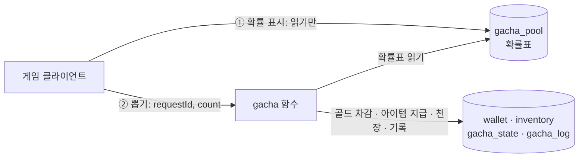

# 아이템 뽑기

골드를 내고 확률에 따라 아이템을 받는 뽑기(확률형 아이템)를 뒤끝펑션으로 만드는 튜토리얼입니다.  
확률 계산, 골드 차감, 천장(일정 횟수 안에 최고 등급 보장)은 모두 함수에서 처리합니다. 게임 클라이언트는 확률표를 **읽어서 보여 주기만** 하므로, 클라이언트를 변조해도 확률과 결과를 바꿀 수 없습니다.  
여기서 만든 지갑·인벤토리 테이블과 뽑은 아이템은 다음 튜토리얼인 [거래소 만들기](/sdk-docs/function/tutorial/exchange)에서 그대로 사용합니다.  

## 준비 사항

- [에코 함수](/sdk-docs/function/tutorial/echo-function) 튜토리얼처럼 프로젝트를 만들고 배포하는 방법을 알고 있어야 합니다.
- 뒤끝 콘솔에서 데이터베이스를 사용할 수 있어야 합니다.
- 뒤끝펑션 인증키가 `backend config`로 등록되어 있어야 합니다. [인증 정보 등록](/sdk-docs/function/cli/setting)
- 시험에 쓸 **테스트 전용 계정 1개**가 필요합니다. 실제로 존재하는 계정이어야 합니다.
- 데이터베이스를 함수에서 쓰는 방법은 [뒤끝 데이터베이스 사용](/sdk-docs/function/backnd-features/database) 문서에서 볼 수 있습니다.

아래 명령은 Windows PowerShell 기준입니다. Mac에서는 터미널에서 같은 명령을 사용하고, 경로만 Mac 형식으로 바꿉니다.  

:::caution 테스트용 프로젝트에서 진행해 주세요
이 튜토리얼은 테이블을 만들고 데이터를 직접 넣으며, 호출할 때마다 실제 데이터가 바뀝니다.  
운영 중인 프로젝트가 아니라 테스트용 프로젝트에서 진행해 주세요.  
:::

## 동작 개요



함수는 요청의 `action` 값으로 동작을 나눕니다.  

| action | 보내는 값 | 하는 일 |
| --- | --- | --- |
| `open` | 없음 | 내 지갑이 없으면 만들고(골드 0), 내 `userId`, `gold`, 천장 카운트(`pity`)를 돌려줍니다. |
| `draw` | `requestId`, `count` | 골드를 내고 `count`개(1~5)를 뽑아 인벤토리에 넣습니다. |

뽑을 때 클라이언트가 보내는 값은 **요청 ID(`requestId`)와 뽑을 개수(`count`)뿐**입니다. 나머지는 모두 함수가 정합니다.  

| 정하는 것 | 정하는 곳 | 이유 |
| --- | --- | --- |
| 아이템별 확률 | `gacha_pool` 테이블 | 게임 화면에 표시하는 확률과 실제로 뽑는 확률이 같은 데이터가 됩니다. |
| 가격 | 함수 코드(`PRICE_PER_DRAW`) | 클라이언트가 가격을 바꿔 보낼 수 없습니다. |
| 뽑기 결과 | 함수 안의 난수 | 클라이언트가 결과를 고를 수 없습니다. |
| 천장 카운트 | `gacha_state` 테이블 | 클라이언트를 지우거나 바꿔도 횟수가 유지됩니다. |
| 같은 요청인지 | `gacha_log` 테이블(기본 키가 요청 ID) | 응답을 받지 못해 다시 보낸 요청은 다시 뽑지 않고 처음 결과를 돌려줍니다. |

이 튜토리얼의 뽑기 규칙은 아래와 같습니다.  

- 한 번 뽑을 때마다 100골드입니다. 한 번에 1개부터 5개까지 뽑을 수 있습니다.
- 등급은 `common`, `rare`, `legendary`(전설) 세 가지입니다.
- 전설 등급 없이 49번 연속으로 뽑으면, 50번째는 반드시 전설 등급이 나옵니다(천장). 전설 등급이 나오면 횟수는 0으로 돌아갑니다.

### 한 번에 5개까지 뽑는 이유

한 번의 뽑기는 골드 차감, 천장 카운트 저장, 아이템 지급, 뽑기 기록을 **트랜잭션 하나**로 저장합니다. 그래서 골드만 빠지고 아이템이 들어오지 않는 일이 생기지 않습니다.  
뒤끝펑션의 트랜잭션에는 작업을 최대 10개까지 넣을 수 있습니다. 이 함수는 아이템 수에 3개(골드, 천장, 기록)를 더한 만큼 작업을 쓰므로 한 번에 최대 7개까지 뽑을 수 있고, 이 튜토리얼은 5개로 정했습니다.  
10개를 뽑는 화면이 필요하다면 함수를 두 번 호출하고(요청 ID도 두 개), 두 결과를 함께 보여 줍니다.  

## 1. 테이블 만들기

뒤끝 콘솔의 [테이블 에디터](/guide/console-guide/database/table-editor)에서 테이블 5개를 만듭니다. 테이블 이름과 컬럼 이름은 아래와 같이 영문 소문자와 언더바(`_`)로 입력합니다.  
테이블을 만든 뒤에는 컬럼을 수정할 수 없고 추가만 할 수 있으므로, 타입을 확인하고 만들어 주세요. 유저 테이블에는 `user_uuid` 컬럼이 자동으로 추가되며, 코드의 모델에는 쓰지 않습니다.  

### wallet (유저 테이블)

플레이어의 골드를 저장합니다.  

| 컬럼 | 타입 | 설명 |
| --- | --- | --- |
| `owner_id` | string | **기본 키.** 지갑 주인의 gamerId입니다. |
| `gold` | int64 | 보유 골드입니다. |

### inventory (유저 테이블)

플레이어가 가진 아이템을 저장합니다. 아이템 한 개가 행 한 개입니다.  

| 컬럼 | 타입 | 설명 |
| --- | --- | --- |
| `item_id` | string | **기본 키.** 아이템 한 개를 구분하는 고유 ID입니다. 같은 종류의 아이템도 하나마다 다릅니다. |
| `item_code` | string | 아이템의 종류를 나타내는 코드입니다. |

### gacha_pool (자유 테이블)

뽑기 확률표입니다. 한 행이 뽑힐 수 있는 아이템 하나입니다.  

| 컬럼 | 타입 | 설명 |
| --- | --- | --- |
| `entry_id` | string | **기본 키.** 확률표 항목 ID입니다. |
| `item_code` | string | 뽑혔을 때 지급할 아이템의 종류 코드입니다. |
| `grade` | string | `common`, `rare`, `legendary` 중 하나입니다. |
| `weight` | int32 | 가중치입니다. 확률은 `weight ÷ 모든 항목의 weight 합`입니다. |

### gacha_state (유저 테이블)

플레이어별 천장 카운트입니다.  

| 컬럼 | 타입 | 설명 |
| --- | --- | --- |
| `owner_id` | string | **기본 키.** 플레이어의 gamerId입니다. |
| `pity` | int32 | 전설 등급 없이 연속으로 뽑은 횟수입니다. |

### gacha_log (자유 테이블)

뽑기 기록입니다. 같은 요청을 다시 받았을 때 돌려줄 결과이자, 문의를 받았을 때 확인할 기록입니다.  

| 컬럼 | 타입 | 설명 |
| --- | --- | --- |
| `request_id` | string | **기본 키.** 클라이언트가 보낸 요청 ID입니다. |
| `owner_id` | string | 뽑은 플레이어의 gamerId입니다. |
| `cost` | int64 | 사용한 골드입니다. |
| `pity_after` | int32 | 이 뽑기가 끝난 뒤의 천장 카운트입니다. |
| `result` | string | 뽑은 아이템 목록(JSON)입니다. |
| `created_at` | datetime | 뽑은 시각(UTC)입니다. |

### 클라이언트 접근 권한

테이블을 만들 때 [클라이언트 접근 권한](/guide/console-guide/database/table-editor#클라이언트-접근-권한)을 아래와 같이 설정합니다.  

| 테이블 | 읽기 | 쓰기 |
| --- | --- | --- |
| `wallet` | 본인 | 모두 해제 |
| `inventory` | 본인 | 모두 해제 |
| `gacha_pool` | 허용 | 모두 해제 |
| `gacha_state` | 본인 | 모두 해제 |
| `gacha_log` | 해제 | 해제 |

:::danger 쓰기 권한을 모두 해제해 주세요
쓰기 권한이 하나라도 남아 있으면 게임 클라이언트가 함수를 거치지 않고 테이블에 직접 쓸 수 있습니다. 예를 들어 `wallet`의 쓰기를 열어 두면 골드를, `gacha_pool`의 쓰기를 열어 두면 확률표를 클라이언트가 바꿀 수 있습니다.  
자유 테이블(`gacha_pool`, `gacha_log`)은 행의 소유자를 구분하지 않으므로, 쓰기 권한을 모두 해제해야 막을 수 있습니다.  
:::

## 2. 확률표 넣기

뒤끝 콘솔의 [테이블 에디터](/guide/console-guide/database/table-editor#데이터-삽입)에서 `gacha_pool`에 아래 5개 행을 넣습니다.  

1. 테이블 목록에서 `gacha_pool`을 선택합니다.  
2. 행 삽입을 누르고, 입력 창에 아래 표의 한 행을 입력해 추가합니다. `확률` 열은 참고용이므로 입력하지 않습니다.  
3. 5개 행을 모두 넣을 때까지 반복합니다.  

| entry_id | item_code | grade | weight | 확률 |
| --- | --- | --- | --- | --- |
| `c-01` | `wood_sword` | `common` | 4000 | 40% |
| `c-02` | `wood_shield` | `common` | 4000 | 40% |
| `r-01` | `silver_sword` | `rare` | 900 | 9% |
| `r-02` | `silver_shield` | `rare` | 1000 | 10% |
| `l-01` | `dragon_sword` | `legendary` | 100 | 1% |

- `grade`는 표와 같이 소문자로, 앞뒤 공백 없이 입력합니다. 다르게 입력한 행이 있으면 함수가 뽑지 않고 그 행의 `entry_id`를 알려 줍니다.
- 가중치의 합이 10000이므로 표의 확률이 됩니다.
- 천장을 위해 `legendary` 항목이 하나 이상 있어야 합니다.

나중에 확률을 바꿀 때는 테이블 에디터에서 `weight` 셀을 더블 클릭해 고칩니다. 함수는 뽑을 때마다 확률표를 읽으므로 다음 뽑기부터 바로 적용되고, 확률표를 읽어 표시하는 게임 화면에도 같은 값이 나옵니다.  

## 3. 프로젝트 만들기

```powershell
mkdir C:\work -Force
cd C:\work
backend new gacha
cd gacha
```

프로젝트 이름 `gacha`가 서버에 배포될 함수 이름이 됩니다.  

## 4. 함수 작성하기

`Function.cs`의 내용을 모두 지우고 아래 코드로 바꾼 뒤, `DATABASE_UUID`의 값을 뒤끝 콘솔의 데이터베이스 [설정](/guide/console-guide/database/settings) 화면에서 복사한 UUID로 바꿉니다.  

```csharp
using System;
using System.Collections.Generic;
using System.IO;
using System.Linq;
using System.Security.Cryptography;
using System.Threading.Tasks;
using Amazon.Lambda.Core;
using BackEnd;
using BACKND.Database;
using BACKND.Database.Exceptions;
using Newtonsoft.Json;
using Newtonsoft.Json.Linq;

[assembly: LambdaSerializer(typeof(Amazon.Lambda.Serialization.Json.JsonSerializer))]

namespace BackendFunction
{
    // 지갑: 유저 테이블. 호출한 사용자 본인의 행만 다룹니다.
    [Table("wallet", TableType.UserTable)]
    public class Wallet : BaseModel
    {
        [PrimaryKey]
        [Column("owner_id", NotNull = true)]
        public string OwnerId { get; set; }

        [Column("gold", NotNull = true)]
        public long Gold { get; set; }
    }

    // 인벤토리: 유저 테이블. 호출한 사용자 본인의 행만 다룹니다.
    [Table("inventory", TableType.UserTable)]
    public class InventoryItem : BaseModel
    {
        [PrimaryKey]
        [Column("item_id", NotNull = true)]
        public string ItemId { get; set; }

        [Column("item_code", NotNull = true)]
        public string ItemCode { get; set; }
    }

    // 확률표: 자유 테이블. 게임 화면의 확률 표시와 함수의 뽑기가 같은 데이터를 씁니다.
    [Table("gacha_pool", TableType.FlexibleTable)]
    public class GachaPoolEntry : BaseModel
    {
        [PrimaryKey]
        [Column("entry_id", NotNull = true)]
        public string EntryId { get; set; }

        [Column("item_code", NotNull = true)]
        public string ItemCode { get; set; }

        [Column("grade", NotNull = true)]
        public string Grade { get; set; }

        [Column("weight", NotNull = true)]
        public int Weight { get; set; }
    }

    // 천장 카운트: 유저 테이블. 전설 등급 없이 연속으로 뽑은 횟수입니다.
    [Table("gacha_state", TableType.UserTable)]
    public class GachaState : BaseModel
    {
        [PrimaryKey]
        [Column("owner_id", NotNull = true)]
        public string OwnerId { get; set; }

        [Column("pity", NotNull = true)]
        public int Pity { get; set; }
    }

    // 뽑기 기록: 자유 테이블. 기본 키가 요청 ID라서 같은 요청은 한 번만 기록됩니다.
    [Table("gacha_log", TableType.FlexibleTable)]
    public class GachaLog : BaseModel
    {
        [PrimaryKey]
        [Column("request_id", NotNull = true)]
        public string RequestId { get; set; }

        [Column("owner_id", NotNull = true)]
        public string OwnerId { get; set; }

        [Column("cost", NotNull = true)]
        public long Cost { get; set; }

        [Column("pity_after", NotNull = true)]
        public int PityAfter { get; set; }

        [Column("result", NotNull = true)]
        public string Result { get; set; }

        [Column("created_at", NotNull = true)]
        public DateTime CreatedAt { get; set; }
    }

    // 이번에 뽑은 아이템 하나입니다. 데이터베이스 테이블이 아닙니다.
    public class DrawnItem
    {
        public string ItemId { get; set; }
        public string ItemCode { get; set; }
        public string Grade { get; set; }
    }

    public class BFunc
    {
        // 뒤끝 콘솔의 데이터베이스 설정 화면에서 복사한 UUID로 바꿉니다.
        private const string DATABASE_UUID = "00000000-0000-0000-0000-000000000000";

        private const long PRICE_PER_DRAW = 100;
        private const int MAX_DRAW_COUNT = 5;
        private const int PITY_LIMIT = 50;
        private const int MAX_ID_LENGTH = 64;
        private const string GRADE_COMMON = "common";
        private const string GRADE_RARE = "rare";
        private const string GRADE_LEGENDARY = "legendary";

        private static Client sDb;

        public async Task<Stream> Function(Stream stream, ILambdaContext context)
        {
            try
            {
                // 뒤끝펑션 SDK를 초기화합니다.
                Backend.Initialize(ref stream);
            }
            catch (Exception e)
            {
                return ReturnErrorObject("initialize " + e.Message);
            }

            // 1. 요청 값을 확인합니다. 뽑을 개수와 요청 ID만 받고, 확률과 가격은 받지 않습니다.
            string action = ReadString("action");

            if (action == null)
            {
                return ReturnErrorObject("action key is not exist");
            }

            string requestId = null;
            int count = 0;

            if (action == "draw")
            {
                requestId = ReadRequestId();

                if (requestId == null)
                {
                    return ReturnErrorObject("requestId is required (1-" + MAX_ID_LENGTH + " characters)");
                }

                count = ReadCount();

                if (count == 0)
                {
                    return ReturnErrorObject("count must be an integer between 1 and " + MAX_DRAW_COUNT);
                }
            }
            else if (action != "open")
            {
                return ReturnErrorObject("unknown action: " + action);
            }

            try
            {
                // 2. 호출한 사용자를 확인합니다. 사용자 ID는 요청 값이 아니라 서버가 확인한 값만 사용합니다.
                var userInfo = Backend.BMember.GetUserInfoV2();

                if (userInfo.IsSuccess() == false)
                {
                    return ReturnErrorObject("fail to get user info: " + userInfo.GetMessage());
                }

                string userId = userInfo.GetReturnValuetoJSON()["row"]["gamerId"].ToString();

                // 3. 동작을 실행합니다.
                if (action == "open")
                {
                    return await Open(userId);
                }

                return await Draw(userId, requestId, count);
            }
            catch (DatabaseException e)
            {
                // FailureKind로 실패 원인을 구분할 수 있습니다.
                return ReturnErrorObject("database " + e.FailureKind + ": " + e.Message);
            }
            catch (Exception e)
            {
                return ReturnErrorObject("unexpected error: " + e.Message);
            }
        }

        // open: 지갑이 없으면 만들고(골드 0), 내 gamerId와 골드, 천장 카운트를 돌려줍니다.
        static async Task<Stream> Open(string userId)
        {
            Client db = GetDb();
            Wallet wallet = await db.From<Wallet>().OfCurrentUser().Where(x => x.OwnerId == userId).FirstOrDefault();

            if (wallet == null)
            {
                wallet = new Wallet { OwnerId = userId, Gold = 0 };
                await db.From<Wallet>().OfCurrentUser().Insert(wallet);
            }

            GachaState state = await db.From<GachaState>().OfCurrentUser().Where(x => x.OwnerId == userId).FirstOrDefault();
            int pity = 0;

            if (state != null)
            {
                pity = state.Pity;
            }

            JObject result = new JObject();
            result.Add("ok", true);
            result.Add("action", "open");
            result.Add("userId", userId);
            result.Add("gold", wallet.Gold);
            result.Add("pity", pity);
            result.Add("pityLimit", PITY_LIMIT);

            return Backend.StringToStream(result.ToString());
        }

        static async Task<Stream> Draw(string userId, string requestId, int count)
        {
            Client db = GetDb();

            // 같은 요청 ID로 이미 뽑았다면 다시 뽑지 않고 그때의 결과를 돌려줍니다.
            GachaLog savedLog = await db.From<GachaLog>().Where(x => x.RequestId == requestId).FirstOrDefault();

            if (savedLog != null)
            {
                return ReturnLog(savedLog, userId);
            }

            // 확률표를 읽습니다. 확률은 요청 값이 아니라 이 테이블로만 정합니다.
            List<GachaPoolEntry> pool = await db.From<GachaPoolEntry>().ToList();
            string poolError = CheckPool(pool);

            if (poolError != null)
            {
                return ReturnErrorObject(poolError);
            }

            // 비용은 요청 값이 아니라 함수의 가격으로 계산합니다.
            long cost = PRICE_PER_DRAW * count;
            Wallet wallet = await db.From<Wallet>().OfCurrentUser().Where(x => x.OwnerId == userId).FirstOrDefault();

            if (wallet == null)
            {
                return ReturnErrorObject("wallet not found; call open first");
            }

            if (wallet.Gold < cost)
            {
                return ReturnErrorObject("not enough gold");
            }

            // 천장 카운트를 읽습니다. 처음 뽑는 사용자는 기록이 없으므로 0입니다.
            GachaState state = await db.From<GachaState>().OfCurrentUser().Where(x => x.OwnerId == userId).FirstOrDefault();
            int pity = 0;

            if (state != null)
            {
                pity = state.Pity;
            }

            List<DrawnItem> items = PickItems(pool, count, pity, out int pityAfter);
            TransactionResult commit = await SaveDraw(db, userId, requestId, cost, state, pityAfter, items);

            if (commit.Success == false)
            {
                // 같은 요청 ID가 먼저 처리되어 기록되었다면 그 결과를 돌려줍니다.
                GachaLog concurrentLog = await db.From<GachaLog>().Where(x => x.RequestId == requestId).FirstOrDefault();

                if (concurrentLog != null)
                {
                    return ReturnLog(concurrentLog, userId);
                }

                return ReturnErrorObject("draw failed: " + commit.Error);
            }

            return ReturnResult(requestId, false, cost, pityAfter, ToJson(items));
        }

        // 확률표의 가중치대로 아이템을 뽑습니다. 천장에 닿으면 전설 등급 안에서 뽑습니다.
        static List<DrawnItem> PickItems(List<GachaPoolEntry> pool, int count, int pity, out int pityAfter)
        {
            List<GachaPoolEntry> ordered = pool.OrderBy(x => x.EntryId, StringComparer.Ordinal).ToList();
            List<GachaPoolEntry> legendary = ordered.Where(x => x.Grade == GRADE_LEGENDARY).ToList();
            List<DrawnItem> items = new List<DrawnItem>();
            pityAfter = pity;

            for (int i = 0; i < count; i++)
            {
                GachaPoolEntry entry;

                if (pityAfter + 1 >= PITY_LIMIT)
                {
                    entry = PickByWeight(legendary);
                }
                else
                {
                    entry = PickByWeight(ordered);
                }

                if (entry.Grade == GRADE_LEGENDARY)
                {
                    pityAfter = 0;
                }
                else
                {
                    pityAfter++;
                }

                items.Add(new DrawnItem { ItemId = Guid.NewGuid().ToString(), ItemCode = entry.ItemCode, Grade = entry.Grade });
            }

            return items;
        }

        // 0부터 가중치 합보다 작은 정수를 하나 뽑아, 그 값이 속한 항목을 고릅니다.
        // RandomNumberGenerator.GetInt32는 운영체제의 암호학적 난수로 범위 안의 모든 값을 같은 확률로 돌려줍니다(나머지 연산 편향 없음).
        // 서버의 함수 실행 환경(AWS Lambda)은 실행 환경을 재사용하거나 스냅샷에서 복원하므로,
        // System.Random이나 static 필드에 저장한 시드·난수 객체를 쓰면 여러 실행 환경이 같은 순서의 결과를 낼 수 있습니다. 매번 이 정적 메서드를 호출합니다.
        static GachaPoolEntry PickByWeight(List<GachaPoolEntry> entries)
        {
            int totalWeight = entries.Sum(x => x.Weight);

            if (totalWeight <= 0)
            {
                throw new InvalidOperationException("the weight table has no positive weight");
            }

            int roll = RandomNumberGenerator.GetInt32(totalWeight);

            foreach (GachaPoolEntry entry in entries)
            {
                if (roll < entry.Weight)
                {
                    return entry;
                }

                roll -= entry.Weight;
            }

            throw new InvalidOperationException("the weight table changed while drawing");
        }

        // 골드 차감, 천장 카운트, 아이템 지급, 뽑기 기록을 한 트랜잭션으로 저장합니다.
        static async Task<TransactionResult> SaveDraw(Client db, string userId, string requestId, long cost, GachaState state, int pityAfter, List<DrawnItem> items)
        {
            TransactionBuilder tx = db.Transaction();

            // 1. 골드를 뺍니다. 골드가 비용 이상일 때만 바뀝니다.
            tx.From<Wallet>().OfCurrentUser().Where(x => x.OwnerId == userId && x.Gold >= cost).Dec(x => x.Gold, cost).Update();

            // 2. 천장 카운트를 저장합니다. 읽은 값과 같을 때만 바뀌므로, 동시에 처리된 다른 뽑기가 있으면 전체가 취소됩니다.
            if (state == null)
            {
                tx.From<GachaState>().OfCurrentUser().Insert(new GachaState { OwnerId = userId, Pity = pityAfter });
            }
            else
            {
                int pityBefore = state.Pity;
                tx.From<GachaState>().OfCurrentUser().Where(x => x.OwnerId == userId && x.Pity == pityBefore).Set(x => x.Pity, pityAfter).Update();
            }

            // 3. 뽑은 아이템을 인벤토리에 넣습니다.
            foreach (DrawnItem item in items)
            {
                tx.From<InventoryItem>().OfCurrentUser().Insert(new InventoryItem { ItemId = item.ItemId, ItemCode = item.ItemCode });
            }

            // 4. 뽑기 기록을 남깁니다. 같은 요청 ID가 이미 있으면 트랜잭션 전체가 취소됩니다.
            GachaLog log = new GachaLog { RequestId = requestId, OwnerId = userId, Cost = cost, PityAfter = pityAfter, Result = ToJson(items).ToString(Formatting.None), CreatedAt = DateTime.UtcNow };
            tx.From<GachaLog>().Insert(log);

            return await tx.Commit();
        }

        // 확률표가 뽑을 수 있는 상태인지 확인합니다. 올바르면 null, 아니면 오류 메시지를 돌려줍니다.
        // 등급 이름이 틀리면(대소문자, 공백 포함) 천장과 확률이 의도와 달라지므로 뽑지 않습니다.
        static string CheckPool(List<GachaPoolEntry> pool)
        {
            if (pool.Count == 0)
            {
                return "gacha pool is empty";
            }

            long totalWeight = 0;
            bool hasLegendary = false;

            foreach (GachaPoolEntry entry in pool)
            {
                if (IsKnownGrade(entry.Grade) == false)
                {
                    return "grade must be common, rare or legendary: " + entry.EntryId;
                }

                if (string.IsNullOrWhiteSpace(entry.ItemCode))
                {
                    return "item_code is empty: " + entry.EntryId;
                }

                if (entry.Weight <= 0)
                {
                    return "weight must be positive: " + entry.EntryId;
                }

                totalWeight += entry.Weight;

                if (entry.Grade == GRADE_LEGENDARY)
                {
                    hasLegendary = true;
                }
            }

            if (totalWeight > int.MaxValue)
            {
                return "total weight is too large";
            }

            if (hasLegendary == false)
            {
                return "gacha pool has no legendary item";
            }

            return null;
        }

        static bool IsKnownGrade(string grade)
        {
            return grade == GRADE_COMMON || grade == GRADE_RARE || grade == GRADE_LEGENDARY;
        }

        // 요청에서 문자열 값을 읽습니다. 키가 없거나 비어 있으면 null을 돌려줍니다.
        static string ReadString(string key)
        {
            if (Backend.HasKey(key) == false)
            {
                return null;
            }

            var value = Backend.Content[key];

            if (value == null)
            {
                return null;
            }

            string text = value.ToString();

            if (string.IsNullOrWhiteSpace(text))
            {
                return null;
            }

            return text;
        }

        // 요청 ID를 읽습니다. 값이 없거나 MAX_ID_LENGTH보다 길면 null을 돌려줍니다.
        static string ReadRequestId()
        {
            string text = ReadString("requestId");

            if (text == null || text.Length > MAX_ID_LENGTH)
            {
                return null;
            }

            return text;
        }

        // 뽑을 개수를 읽습니다. 1 이상 MAX_DRAW_COUNT 이하가 아니면 0을 돌려줍니다.
        static int ReadCount()
        {
            string text = ReadString("count");

            if (text == null || int.TryParse(text, out int count) == false)
            {
                return 0;
            }

            if (count < 1 || count > MAX_DRAW_COUNT)
            {
                return 0;
            }

            return count;
        }

        // 저장된 뽑기 기록을 돌려줍니다. 다른 사용자의 요청 ID면 거부합니다.
        static Stream ReturnLog(GachaLog log, string userId)
        {
            if (log.OwnerId != userId)
            {
                return ReturnErrorObject("requestId is already used");
            }

            return ReturnResult(log.RequestId, true, log.Cost, log.PityAfter, JArray.Parse(log.Result));
        }

        static Stream ReturnResult(string requestId, bool replayed, long cost, int pity, JArray items)
        {
            JObject result = new JObject();
            result.Add("ok", true);
            result.Add("action", "draw");
            result.Add("requestId", requestId);
            result.Add("replayed", replayed);
            result.Add("cost", cost);
            result.Add("pity", pity);
            result.Add("pityLimit", PITY_LIMIT);
            result.Add("items", items);

            return Backend.StringToStream(result.ToString());
        }

        static JArray ToJson(List<DrawnItem> items)
        {
            JArray array = new JArray();

            foreach (DrawnItem item in items)
            {
                JObject json = new JObject();
                json.Add("itemId", item.ItemId);
                json.Add("itemCode", item.ItemCode);
                json.Add("grade", item.Grade);
                array.Add(json);
            }

            return array;
        }

        // 데이터베이스 클라이언트를 처음 필요할 때 한 번 만들어 재사용합니다.
        static Client GetDb()
        {
            if (sDb == null)
            {
                sDb = new Client(DATABASE_UUID);
            }

            return sDb;
        }

        static Stream ReturnErrorObject(string err)
        {
            JObject error = new JObject();
            error.Add("error", err);

            return Backend.StringToStream(error.ToString());
        }
    }
}
```

### 코드에서 확인할 점

- **처리 순서**: 요청 값 확인, 호출한 사용자 확인, 같은 요청인지 확인, 확률표·지갑·천장 카운트 읽기, 뽑기, 저장 순서입니다.
- **같은 요청 ID**: `gacha_log`에 같은 요청 ID가 있으면 다시 뽑지 않고 저장된 결과를 `"replayed": true`와 함께 돌려줍니다. 다른 사용자의 요청 ID면 `requestId is already used`를 돌려줍니다.
- **난수**: `RandomNumberGenerator.GetInt32`로 함수 안에서 뽑습니다. 클라이언트가 보낸 값은 결과에 영향을 주지 않습니다.
- **가중치 뽑기**: `PickByWeight`는 0부터 가중치 합보다 작은 수를 하나 뽑고, 항목을 차례로 지나가며 그 수가 속한 항목을 고릅니다.
- **천장**: `PickItems`는 이번 뽑기가 천장 횟수(50번째)에 닿으면 전설 등급 항목 안에서만 뽑고, 전설 등급이 나오면 카운트를 0으로 돌립니다.
- **확률표 확인**: `CheckPool`은 등급 이름, 아이템 코드, 가중치가 올바르지 않은 행이 있으면 뽑지 않습니다.
- **결과 확인**: `Commit()`은 실패해도 예외를 던지지 않으므로 `commit.Success`를 확인합니다.
- **돌려주는 값**: 성공하면 뽑은 아이템 목록(`items`)과 천장 카운트(`pity`, `pityLimit`)를, 실패하면 `{"error": "..."}`를 반환합니다.

트랜잭션에 넣는 쓰기와, 트랜잭션 전체가 취소되는 경우는 아래와 같습니다. 취소되면 아무것도 바뀌지 않습니다.  

| 순서 | 쓰기 | 전체가 취소되는 경우 |
| --- | --- | --- |
| 1 | `wallet`의 골드 차감 | 골드가 비용보다 적습니다. |
| 2 | `gacha_state`의 천장 카운트 저장(처음이면 추가) | 읽은 뒤에 다른 뽑기가 먼저 끝나 카운트가 바뀌었습니다. |
| 3 | `inventory`에 아이템 추가(뽑은 개수만큼) | 없음 |
| 4 | `gacha_log`에 기록 추가 | 같은 요청 ID의 기록이 먼저 저장되었습니다. |

## 5. 내 PC에서 확인하기

이 함수는 데이터베이스에 쓰기 때문에 내 PC에서는 **요청 값 확인까지만** 시험할 수 있습니다.  

`requests/default.json`의 내용을 아래와 같이 바꾸고 실행합니다.  

```json
{}
```

```powershell
backend debug
```

결과의 `execution.result`가 아래와 같으면 정상입니다.  

```json
"result": {
  "error": "action key is not exist"
}
```

이번에는 뽑을 개수가 범위를 벗어난 요청을 보냅니다. `requests/count6.json` 파일을 만들고 아래 내용을 넣습니다.  

```json
{
  "action": "draw",
  "requestId": "draw-test-0001",
  "count": 6
}
```

```powershell
backend debug --data count6
```

```json
"result": {
  "error": "count must be an integer between 1 and 5"
}
```

마지막으로 `requests/open.json` 파일을 만들고 아래 내용을 넣습니다. 7단계에서도 이 파일을 사용합니다.  

```json
{
  "action": "open"
}
```

```powershell
backend debug --data open
```

인증 정보 없이 실행했으므로 호출한 사용자를 확인하지 못하고 멈춥니다. `result`의 `error`가 `fail to get user info:`로 시작하면 정상입니다.  

### 내 PC에서 확인할 수 없는 것

- `backend debug`는 데이터베이스에 접근하는 부분까지 가지 못합니다. 호출한 사용자가 있어야 하기 때문입니다.
- 테스트 계정으로 실행하는 `backend debug --user`는 게임 클라이언트와 같은 테이블 권한을 받습니다. 쓰기를 막아 둔 테이블에 쓰는 동작은 실패합니다.
- 서버에 배포한 함수만 테이블 권한을 받지 않고 쓸 수 있습니다.

## 6. 서버에 배포하기

```powershell
backend deploy
```

확인 질문 바로 위에 `Deploy function 'gacha' with profile '...'` 안내가 표시됩니다. 인증키를 등록한 프로필이 맞는지 확인하고 `y`를 입력합니다.  
배포 직후 몇 초 동안은 호출이 실패할 수 있으니 잠시 기다린 뒤 호출해 주세요. [배포](/sdk-docs/function/cli/deploy)  

## 7. 테스트 계정과 골드 준비하기

### 테스트 계정 프로필 등록하기

시험에 쓸 테스트 계정을 `seller` 프로필로 등록합니다. 이 계정이 뽑은 아이템을 다음 튜토리얼인 거래소 만들기에서 판매하므로 이름을 `seller`로 정합니다.  
프로젝트 폴더에서 아래 명령을 실행합니다. 질문마다 뒤끝펑션 인증키, 클라이언트 앱 ID, 시그니처 키, 패키지 이름을 입력하고, 테스트 계정 로그인 질문에는 `y`를 입력해 로그인합니다.  

```powershell
backend config --profile seller
```

질문의 자세한 내용은 [인증 정보 등록](/sdk-docs/function/cli/setting)을 참고해 주세요.  

:::caution 테스트 계정은 한 곳에서만 로그인됩니다
같은 계정으로 유니티 등 다른 곳에서 로그인하면 이 로그인이 끝납니다. 게임을 하는 실제 계정이 아니라 테스트 전용 계정을 사용해 주세요.  
:::

### 지갑을 만들고 gamerId 확인하기

`open`을 호출합니다. 확인 질문이 표시되면 `y`를 입력합니다.  
`backend invoke`는 프로젝트 폴더에서 실행하며, 함수가 돌려준 JSON은 결과의 `data.functionResult`에서 확인합니다. [원격 호출과 조회](/sdk-docs/function/cli/invoke)  

```powershell
backend invoke gacha --data open --profile seller
```

함수가 아래와 같은 JSON을 돌려주면 지갑이 만들어진 것입니다. `userId`가 이 계정의 gamerId이므로 적어 둡니다.  

```json
{
  "ok": true,
  "action": "open",
  "userId": "<계정의 gamerId>",
  "gold": 0,
  "pity": 0,
  "pityLimit": 50
}
```

### 골드 넣기

클라이언트는 쓰기가 막혀 있으므로, 골드는 뒤끝 콘솔의 [테이블 에디터](/guide/console-guide/database/table-editor#데이터-수정)에서 넣습니다.  

1. 테이블 목록에서 `wallet`을 선택합니다.  
2. `owner_id`가 위에서 적어 둔 `userId`와 같은 행을 찾습니다.  
3. 그 행의 `gold` 셀을 더블 클릭하고 `10000`을 입력해 저장합니다.  

## 8. 호출해 확인하기

모든 호출은 프로젝트 폴더에서 `backend invoke gacha --data <파일 이름> --profile seller`로 실행합니다. `backend invoke`는 확인 질문을 표시하므로 `y`를 입력합니다.  
호출한 뒤에는 테이블 에디터에서 테이블을 선택해 데이터가 어떻게 바뀌었는지 확인할 수 있습니다.  

### 한 개 뽑기

`requests/draw1.json` 파일을 만들고 아래 내용을 넣습니다.  

```json
{
  "action": "draw",
  "requestId": "draw-test-0001",
  "count": 1
}
```

```powershell
backend invoke gacha --data draw1 --profile seller
```

함수가 아래와 같은 JSON을 돌려주면 성공입니다. 뽑힌 아이템은 확률에 따라 달라집니다.  

```json
{
  "ok": true,
  "action": "draw",
  "requestId": "draw-test-0001",
  "replayed": false,
  "cost": 100,
  "pity": 1,
  "pityLimit": 50,
  "items": [
    {
      "itemId": "<새 아이템 ID>",
      "itemCode": "wood_sword",
      "grade": "common"
    }
  ]
}
```

테이블 에디터에서 아래와 같이 바뀐 것을 확인합니다.  

| 테이블 | 바뀐 내용 |
| --- | --- |
| `wallet` | `gold`가 9900입니다. |
| `inventory` | `items`의 `itemId`와 같은 `item_id`의 행이 생겼습니다. |
| `gacha_state` | 행이 생겼고 `pity`가 결과의 `pity`와 같습니다. |
| `gacha_log` | `request_id`가 `draw-test-0001`인 행이 생겼습니다. |

### 같은 요청을 다시 보내기

같은 `draw1`을 한 번 더 보냅니다. 클라이언트가 응답을 받지 못해 다시 보내는 상황과 같습니다.  

```powershell
backend invoke gacha --data draw1 --profile seller
```

`"replayed": true`와 함께 **처음과 같은 아이템**이 돌아옵니다. 골드는 줄지 않고, `inventory`와 `gacha_log`에도 행이 늘지 않습니다.  
골드는 `open`으로도 확인할 수 있습니다. `"gold": 9900`이 그대로면 정상입니다.  

```powershell
backend invoke gacha --data open --profile seller
```

### 다섯 개 뽑기

`requests/draw5.json` 파일을 만들고 아래 내용을 넣습니다. 새로 뽑을 때는 **요청 ID를 바꿔야** 합니다. 같은 요청 ID는 이미 뽑은 결과를 돌려주기 때문입니다.  

```json
{
  "action": "draw",
  "requestId": "draw-test-0002",
  "count": 5
}
```

```powershell
backend invoke gacha --data draw5 --profile seller
```

`items`에 아이템 5개가 돌아오고, `cost`는 500입니다.  

### 천장 확인하기

전설 등급은 1% 확률이라 쉽게 나오지 않으므로, 천장 카운트를 49로 바꿔 천장을 확인합니다.  

1. 테이블 에디터의 테이블 목록에서 `gacha_state`를 선택합니다.  
2. `owner_id`가 적어 둔 `userId`와 같은 행의 `pity` 셀을 더블 클릭하고 `49`를 입력해 저장합니다.  
3. `requests/draw1.json`의 `requestId`를 `draw-test-0003`으로 바꾸고 다시 뽑습니다.  

```powershell
backend invoke gacha --data draw1 --profile seller
```

`items`의 `grade`가 `legendary`이고 `pity`가 0이면 천장이 동작한 것입니다.  

### 실패하는 경우

| 함수가 돌려준 `error` | 원인과 해결 방법 |
| --- | --- |
| `action key is not exist`, `unknown action: ...` | `action`이 없거나 `open`, `draw`가 아닙니다. |
| `requestId is required (1-64 characters)` | `requestId`가 없거나 64자보다 깁니다. |
| `count must be an integer between 1 and 5` | `count`가 1~5의 정수가 아닙니다. |
| `wallet not found; call open first` | 지갑이 없습니다. `open`을 먼저 호출합니다. |
| `not enough gold` | 골드가 비용보다 적습니다. 7단계처럼 테이블 에디터에서 골드를 넣습니다. |
| `gacha pool is empty`, `gacha pool has no legendary item` | 확률표가 비어 있거나 `legendary` 항목이 없습니다. 2단계를 확인합니다. |
| `grade must be common, rare or legendary: ...`, `item_code is empty: ...`, `weight must be positive: ...` | 메시지 끝의 `entry_id` 행에 잘못 입력한 값이 있습니다. 테이블 에디터에서 그 행을 고칩니다. |
| `requestId is already used` | 다른 사용자가 이미 쓴 요청 ID입니다. 새 요청 ID로 보냅니다. |
| `draw failed: ...` | 동시에 처리된 다른 뽑기 때문에 취소되었습니다. 같은 요청 ID로 다시 보냅니다. 처음 요청이 실제로 저장되었다면 그 결과가 돌아옵니다. |
| `database Validation: The database UUID ...` | `DATABASE_UUID`를 바꾸지 않았습니다. |

## 9. 유니티에서 호출하기

유니티에서는 두 가지를 합니다. 확률표를 읽어 확률을 보여 주고, 뽑기 버튼을 누르면 `gacha` 함수를 호출합니다.  
확률표 읽기는 클라이언트의 데이터베이스 SDK를 사용합니다. 아래 코드의 `DatabaseManager.DBClient`는 데이터베이스 [시작하기](/sdk-docs/database/intro) 문서의 초기화 예제에서 만든 `Client`입니다.  

```csharp
using System;
using System.Collections.Generic;
using BACKND.Database;
using BackEnd;
using UnityEngine;

// 확률표: 함수의 GachaPoolEntry와 같은 테이블입니다.
[Table("gacha_pool", TableType.FlexibleTable)]
public class GachaPoolEntry : BaseModel
{
    [PrimaryKey]
    [Column("entry_id", NotNull = true)]
    public string EntryId { get; set; }

    [Column("item_code", NotNull = true)]
    public string ItemCode { get; set; }

    [Column("grade", NotNull = true)]
    public string Grade { get; set; }

    [Column("weight", NotNull = true)]
    public int Weight { get; set; }
}

public class GachaExample : MonoBehaviour
{
    // 성공 결과를 받기 전까지는 같은 요청 ID를 다시 사용합니다.
    private string mPendingRequestId;

    // 확률표를 읽어 아이템별 확률을 표시합니다. 함수가 뽑을 때 쓰는 확률표와 같은 데이터입니다.
    public async void ShowOdds()
    {
        List<GachaPoolEntry> pool = await DatabaseManager.DBClient.From<GachaPoolEntry>().ToList();
        long totalWeight = 0;

        foreach (GachaPoolEntry entry in pool)
        {
            totalWeight += entry.Weight;
        }

        foreach (GachaPoolEntry entry in pool)
        {
            double percent = entry.Weight * 100.0 / totalWeight;
            Debug.Log(entry.ItemCode + " (" + entry.Grade + "): " + percent.ToString("0.##") + "%");
        }

        Debug.Log("전설 등급 없이 49번 뽑으면 50번째는 전설 등급이 나옵니다.");
    }

    // count개(1~5)를 뽑습니다.
    public void Draw(int count)
    {
        if (mPendingRequestId == null)
        {
            mPendingRequestId = Guid.NewGuid().ToString();
        }

        Param param = new Param();
        param.Add("action", "draw");
        param.Add("requestId", mPendingRequestId);
        param.Add("count", count);

        var bro = Backend.BFunc.InvokeFunction("gacha", param);

        if (bro.IsSuccess() == false)
        {
            // 결과를 받지 못했습니다. 다시 누르면 같은 요청 ID로 보내므로 두 번 뽑히지 않습니다.
            Debug.LogError("뒤끝펑션 호출 실패: " + bro);
            return;
        }

        var result = bro.GetReturnValuetoJSON()["result"];

        if (result.IsObject && result.ContainsKey("error"))
        {
            // 함수가 처리하지 못했습니다. 실제로는 저장되었을 수도 있으므로 같은 요청 ID를 유지합니다.
            Debug.LogError("뽑기 실패: " + result["error"]);
            return;
        }

        // 결과를 받았으므로 다음 뽑기는 새 요청 ID로 보냅니다.
        mPendingRequestId = null;

        var items = result["items"];

        for (int i = 0; i < items.Count; i++)
        {
            Debug.Log("획득: " + items[i]["itemCode"] + " (" + items[i]["grade"] + ")");
        }

        int remaining = int.Parse(result["pityLimit"].ToString()) - int.Parse(result["pity"].ToString());
        Debug.Log("전설 등급 보장까지 " + remaining + "회");
    }
}
```

- **요청 ID**: 뽑기 버튼을 처음 누를 때 `Guid.NewGuid()`로 만들고, 성공 결과를 받을 때까지 바꾸지 않습니다. 네트워크 오류 뒤에 다시 눌러도 같은 요청 ID로 보내므로 골드가 두 번 빠지지 않습니다.
- **결과 확인**: `InvokeFunction`은 함수 안에서 오류가 나도 성공으로 끝납니다. 함수가 성공했는지는 `result`에 `error`가 있는지로 확인합니다. [결과 반환하기](/sdk-docs/function/request-response/return-result)
- 유니티의 `GachaPoolEntry` 모델은 콘솔의 `gacha_pool` 테이블과 테이블 이름, 컬럼 이름, 타입이 같아야 합니다. 데이터 조회 방법은 [데이터 조회](/sdk-docs/database/query) 문서를 참고해 주세요.

:::info 확률 공개
확률형 아이템은 구매 전에 확률을 공개해야 하는 경우가 많습니다. 예를 들어 한국 게임산업법은 2024년 3월 22일부터 [확률형 아이템의 종류와 확률을 공개](https://www.korea.kr/docViewer/result/2024.03/22/355dac8d367618b0ebfdccb59e662d44/355dac8d367618b0ebfdccb59e662d44.view.xhtml)하도록 하고, App Store 심사 지침은 [구매 전에 아이템별 확률을 공개](https://developer.apple.com/app-store/review/guidelines/#in-app-purchase)하도록 요구합니다. 서비스하는 국가와 스토어의 규정을 확인해 주세요.  
이 튜토리얼처럼 확률표를 데이터베이스 한 곳에 두고 함수와 게임 화면이 함께 읽으면, 표시하는 확률과 실제로 뽑는 확률이 항상 같습니다. 천장 규칙도 함께 안내해 주세요.  
:::

## 안전하게 만들기 위한 규칙

뽑기는 클라이언트를 변조해 이득을 보려는 시도가 가장 많은 기능입니다. 이 튜토리얼의 코드가 지키는 규칙입니다.  

- **확률, 가격, 사용자 ID는 요청 값으로 받지 않습니다.** 확률은 `gacha_pool`, 가격은 함수 코드, 사용자 ID는 서버가 확인한 gamerId를 씁니다. 요청 값은 요청 ID와 개수뿐이고, 개수는 범위(1~5)를 확인합니다.
- **결과는 함수 안에서 정합니다.** 난수는 함수 안에서 `RandomNumberGenerator`로 뽑고, 클라이언트가 보낸 값으로 결과가 바뀌지 않게 합니다.
- **테이블 쓰기 권한을 해제합니다.** 해제하지 않으면 클라이언트가 확률표, 천장 카운트, 지갑을 직접 바꿀 수 있습니다.
- **골드 차감, 천장 카운트, 아이템 지급, 기록을 트랜잭션 하나로 저장합니다.** 하나라도 실패하면 모두 취소되어 골드만 빠지는 일이 없습니다.
- **같은 요청은 한 번만 처리합니다.** 요청 ID를 기록의 기본 키로 써서, 다시 보낸 요청에는 처음 결과를 돌려줍니다.
- **읽은 천장 카운트는 저장할 때 다시 확인합니다.** 동시에 두 번 뽑으면 한쪽은 카운트 조건이 맞지 않아 취소되므로, 천장이 두 번 적용되지 않습니다.
- **기록을 남깁니다.** `gacha_log`에 누가 언제 무엇을 뽑았는지 남아 있어 문의를 확인할 수 있습니다. 플레이어별로 자주 조회한다면 콘솔에서 `owner_id`에 인덱스를 추가해 주세요.

뽑은 아이템은 다음 튜토리얼인 [거래소 만들기](/sdk-docs/function/tutorial/exchange)에서 다른 플레이어에게 판매합니다.  
